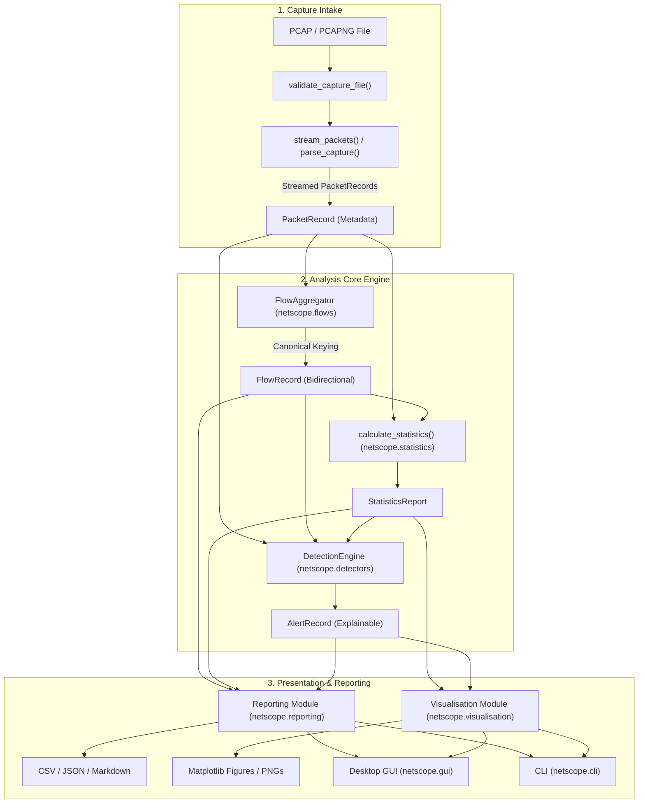

# NetScope — Network Traffic Analyzer & Explainable Anomaly Detection System

[](https://www.python.org/)
[](LICENSE)
[](tests/)
[](#defensive-boundaries-and-limitations)

**NetScope** is a high-performance, offline-first network traffic analysis system and explainable anomaly detection engine written in Python. It converts saved **PCAP** and **PCAPNG** capture files into structured packet metadata, canonical bidirectional flows, comprehensive protocol and endpoint profiles, time-series traffic distributions, and rule-based anomaly indicators.

NetScope features a clean, decoupled architecture: a shared core analysis engine powers both a **scriptable Command-Line Interface (CLI)** and a **responsive Tkinter/ttk desktop Graphical User Interface (GUI)** with embedded Matplotlib visualizations.

---

## Table of Contents
1. [Product Vision & Problem Statement](#product-vision--problem-statement)
2. [Key Features](#key-features)
3. [Technology Stack](#technology-stack)
4. [Component Architecture & Pipeline](#component-architecture--pipeline)
5. [Installation & Setup](#installation--setup)
6. [Usage Guide](#usage-guide)
   - [Desktop GUI](#1-desktop-gui)
   - [Command-Line Interface (CLI)](#2-command-line-interface-cli)
   - [Reproducible Demonstration](#3-reproducible-demonstration)
7. [Detection Rules & Explainability](#detection-rules--explainability)
8. [Export Formats](#export-formats)
9. [Automated Testing](#automated-testing)
10. [Defensive Boundaries & Limitations](#defensive-boundaries--limitations)
11. [Troubleshooting](#troubleshooting)
12. [Project Documentation Directory](#project-documentation-directory)

---

## Product Vision & Problem Statement

Raw network packet captures contain millions of bytes of binary data. Security analysts, network engineers, and students are often faced with thousands of individual packets in Wireshark without an immediate high-level summary of:
- Which endpoints communicated and for how long?
- How balanced was directional communication ($A \to B$ vs $B \to A$)?
- What protocol distributions and packet length characteristics existed?
- Which traffic patterns departed from baseline expectations or exhibited scan heuristics?

**NetScope solves this** by automating the ingestion, bidirectional aggregation, statistical profiling, and rule evaluation over captured traffic. It is strictly **explainable**: every anomaly alert is accompanied by the exact mathematical threshold, observed values, time window, and likely benign false-positive scenarios.

---

## Key Features

- **Multi-Protocol Dissection**: Incremental extraction of IPv4, IPv6, TCP (with control flags), UDP, ICMP, ICMPv6, and DNS query metadata using streaming Scapy readers.
- **Canonical Bidirectional Flow Engine**: Deterministic endpoint ordering `(protocol, min(EP_A, EP_B), max(EP_A, EP_B))` ensuring reverse packets map to the identical flow record with directional packet/byte accounting.
- **Descriptive Statistical Profiling**:
  - Full protocol distributions (counts, bytes, percentages).
  - Packet wire length statistics (min, max, mean, median, 25th/75th/95th percentiles, standard deviation, and Ethernet frame size bins).
  - Endpoint rankings and destination-port diversity tracking.
  - Time-series traffic bucketing (packets/sec, bytes/sec).
- **Explainable Anomaly Detection**: 6 deterministic, configurable rules evaluating packet rates, destination port diversity, TCP SYN-without-ACK ratios, statistical volume deviations ($Z$-score), traffic concentration, and repetitive communication bursts.
- **Modern Desktop GUI**:
  - Built with Tkinter and themed ttk widgets.
  - Multi-tab navigation: Summary Cards, Bidirectional Flows, Endpoints, Anomaly Alerts (with master-detail evidence view), Visualizations, and Reports.
  - Column-sorting treeviews (numeric and alphabetical).
  - Embedded Matplotlib canvases with dynamic chart switching.
  - Non-blocking background worker thread ensuring continuous GUI responsiveness.
- **Automated CLI & Reporting**:
  - Scriptable `argparse` execution with formatted terminal summary tables.
  - Multi-format exports: tabular CSVs, structured JSON schema, and human-readable Markdown analysis reports.
  - Automated generation of high-resolution chart images.

---

## Technology Stack

| Technology | Role & Purpose | Justification |
|---|---|---|
| **Python 3.11** | Core Language | Expressive, cross-platform standard with robust standard library. |
| **Scapy (2.8.0)** | Packet Dissection | Industry-standard packet decoding supporting standard PCAP and PCAPNG formats. |
| **NumPy (2.1.3)** | Numerical Calculations | High-performance percentile calculation, standard deviations, and array math. |
| **Pandas (2.2.3)** | Tabular Structures | Flexible multi-attribute aggregation where appropriate. |
| **Matplotlib (3.10.7)** | Visualizations | Publication-quality charts (donut share, time-series, histograms, bar charts) decoupled from UI. |
| **Tkinter / ttk** | Desktop Interface | Zero-dependency, lightweight, cross-platform native desktop GUI. |
| **pytest (8.4.1)** | Test Automation | Fast, fixture-driven unit and integration testing. |
| **Standard Library** | System & I/O | Dataclasses, typing, csv, json, pathlib, logging, queue, threading. |

---

## Component Architecture & Pipeline

NetScope enforces strict separation between input processing, analytical aggregation, detection, and presentation logic. Both the CLI and GUI call the exact same underlying pipeline functions.



---

## Installation & Setup

### 1. Prerequisites
- **Python 3.9+** (Tested on Python 3.11.4).
- Windows, macOS, or Linux.
- Note: Live packet capture is intentionally omitted. No special administrator/root privileges or Npcap driver installation are required to analyze saved PCAP files.

### 2. Clone and Setup Environment
```powershell
# Clone the repository
git clone https://github.com/your-username/netscope.git
cd netscope

# Create and activate a virtual environment
python -m venv .venv
# Windows:
.venv\Scripts\activate
# Linux/macOS:
# source .venv/bin/activate

# Install required dependencies
pip install -r requirements.txt
```

---

## Usage Guide

### 1. Desktop GUI

Launch the interactive desktop application:
```powershell
python -m netscope.gui
```
*Or using the CLI shortcut:*
```powershell
python -m netscope.cli --gui
```

#### GUI Workflow:
1. Click **Browse...** to select any PCAP or PCAPNG capture file.
2. Click **Analyse Capture**. The background worker thread parses packets and populates all tabs without freezing the interface.
3. Review key metrics on the **Summary Overview** tab.
4. Inspect flows on the **Bidirectional Flows** tab (click column headers to sort).
5. Review anomaly alerts on the **Anomaly Alerts** tab; click any row to read the exact evidence and false-positive guidance.
6. Switch between charts on the **Visualisations** tab.
7. Click **Export All Formats** on the **Reports & Exports** tab to save CSVs, JSON, and Markdown reports.

---

### 2. Command-Line Interface (CLI)

Run repeatable, automated analysis directly from the terminal:

```powershell
# Basic analysis with terminal summary and default report exports:
python -m netscope.cli --input samples/synthetic_demo.pcap

# Custom output directory with high-resolution chart images:
python -m netscope.cli --input samples/synthetic_demo.pcap --output reports/my_analysis --charts

# Analysis with custom JSON detection configuration:
python -m netscope.cli --input samples/synthetic_demo.pcap --config custom_config.json --output reports/custom

# View all CLI options:
python -m netscope.cli --help
```

---

### 3. Reproducible Demonstration

Generate a 100% synthetic, legally clean packet capture containing HTTP, DNS, ICMP, IPv6, and controlled anomaly patterns:
```powershell
# 1. Generate synthetic demonstration capture
python samples/generate_sample_pcap.py

# 2. Run NetScope CLI against the generated sample
python -m netscope.cli --input samples/synthetic_demo.pcap --output reports/demo --charts
```

---

## Detection Rules & Explainability

Each rule is deterministic, configurable, and produces an `AlertRecord` with transparent mathematical evidence:

| Rule ID | Rule Name | Purpose & Trigger Logic | Default Threshold | Likely False-Positive Context |
|---|---|---|---|---|
| `RULE_HIGH_PACKET_RATE` | High Packet Rate Observation | Identifies source endpoints transmitting an unusually high volume of packets within a sliding window. | `> 50` packets / `1.0s` | Legitimate bulk downloads, video streaming, database replication. |
| `RULE_PORT_DIVERSITY` | Destination Port Diversity | Identifies sources contacting many distinct destination ports within a window (scanning heuristic). | `> 15` distinct ports / `10.0s` | Web browsers fetching multi-origin assets, P2P clients, service discovery. |
| `RULE_SYN_WITHOUT_ACK` | High TCP SYN Ratio | Calculates ratio of TCP SYN packets (without ACK) against total TCP packets for a source. | `≥ 75.0%` (min `10` TCP packets) | Asymmetric routing (ACKs take another interface), unreachable servers, packet drops. |
| `RULE_VOLUME_DEVIATION` | Volume Statistical Deviation | Flags discrete capture intervals whose byte volume departs from the capture baseline mean. | $Z\text{-score} > +2.5$ (min `4` intervals) | Scheduled backups, bursty media streaming, large file transfers. |
| `RULE_TRAFFIC_CONCENTRATION` | Traffic Concentration | Identifies single endpoints responsible for an overwhelming proportion of capture volume. | `≥ 50.0%` of capture volume (min `30` packets) | Central file servers, default gateway router, local DNS resolver. |
| `RULE_REPEATED_COMMUNICATION` | Repeated Communication | Identifies rapid repetitive bursts between specific source and destination endpoints. | `> 25` identical packets / `5.0s` | Application health checks, keep-alive heartbeats, rapid API polling. |

---

## Export Formats

Exports are written to the specified output directory:
- `flows.csv`: Bidirectional flow table including `flow_id`, directional packet/byte counts, durations, and TCP flag counts.
- `alerts.csv`: Tabular anomaly records including severity, rule name, observed vs threshold, and evidence summary.
- `endpoints.csv`: Observed IP metrics, packet/byte counts, and distinct destination ports contacted.
- `report.json`: Machine-readable document conforming to JSON specification containing full capture metadata, configuration, distributions, flows, and alerts.
- `report.md`: Comprehensive human-readable executive analysis report.
- `charts/*.png`: High-resolution Matplotlib figures (Protocol share, traffic time-series, endpoint profiles, packet size bins, alert breakdown).

---

## Automated Testing

NetScope uses **pytest** with 100% offline synthetic fixtures. No live network or administrative privileges are needed.

Execute the test suite:
```powershell
python -m pytest -v
```

### Verified Test Summary (34 Tests Passing):
```
tests/test_cli.py ........ 4 passed
tests/test_detectors.py .. 6 passed
tests/test_flows.py ...... 7 passed
tests/test_integration.py  1 passed
tests/test_parser.py ..... 7 passed
tests/test_reporting.py .. 4 passed
tests/test_statistics.py . 5 passed
======================= 34 passed in 1.29s =======================
```

---

## Defensive Boundaries & Limitations

NetScope is strictly an **offline defensive analysis tool**.

1. **Header Metadata vs Payload**: NetScope inspects packet headers and flow timing. Transport Layer Security (TLS/HTTPS) and encrypted protocols prevent application payload inspection; application data is neither decrypted nor guessed.
2. **Flow Grouping vs State Machine Reconstruction**: NetScope aggregates packets into bidirectional flows. It does not perform full TCP stack emulation, connection state reconstruction, or retransmission tracking.
3. **Anomaly Indicators vs Conclusive Attribution**: Detection rules identify traffic patterns departing from mathematical baselines. High volume, destination port diversity, and high SYN ratios can be caused by legitimate software or network anomalies. NetScope flags patterns requiring investigation rather than asserting confirmed intrusions.
4. **No Active Network Modification**: NetScope never transmits packets, injects traffic, alters network configurations, or blocks endpoints.

---

## Troubleshooting

| Issue | Cause | Solution |
|---|---|---|
| `No libpcap provider available` warning on Windows | Scapy prints a warning if Npcap is not installed on Windows. | This warning is harmless for offline PCAP reading. Pure-Python file parsing works completely. |
| `InvalidCaptureError: Capture file is empty` | 0-byte file selected. | Select a valid PCAP or PCAPNG file. Run `python samples/generate_sample_pcap.py` to create a sample. |
| Tkinter window does not appear on headless Linux | Missing X11/Wayland display server. | Use the CLI interface (`python -m netscope.cli`) which runs 100% headless. |

---

## Project Documentation Directory

Detailed technical engineering documents are located in [`docs/`](docs/):
- [`docs/architecture.md`](docs/architecture.md) — Architectural design, module responsibilities, threading model.
- [`docs/detection_rules.md`](docs/detection_rules.md) — Mathematical formulas, evidence schema, and false-positive scenarios.
- [`docs/data_model.md`](docs/data_model.md) — Typed data models, bidirectional flow key ordering, wire-length convention.
- [`docs/testing.md`](docs/testing.md) — Testing strategy, synthetic fixtures, boundary coverage.
- [`docs/interview_guide.md`](docs/interview_guide.md) — Comprehensive technical interview preparation guide with 18 in-depth questions and answers.

---

## License

This project is licensed under the MIT License — see the [LICENSE](LICENSE) file for details.
