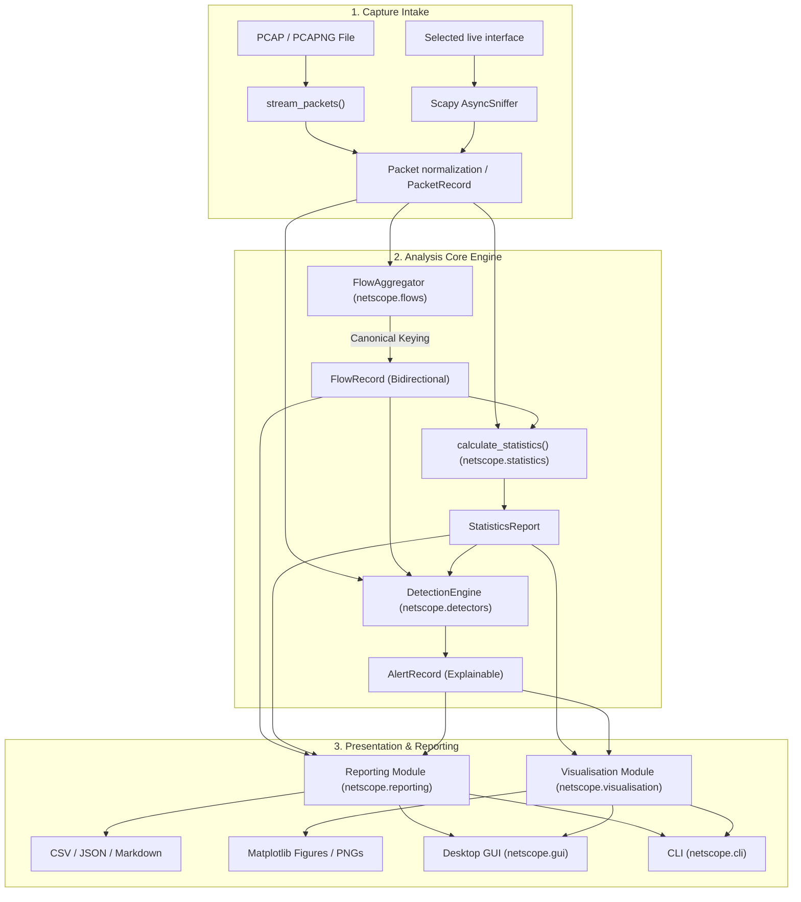

# NetScope — Network Traffic Analyzer & Explainable Anomaly Detection System

[](https://www.python.org/)
[](LICENSE)
[](tests/)
[](#defensive-boundaries-and-limitations)

**NetScope** is a Python network traffic analyzer for offline **PCAP/PCAPNG analysis** and **live network monitoring**. Both modes use the same packet normalization, bidirectional flow aggregation, statistics, and explainable rule-based detection components.

NetScope features a clean, decoupled architecture: a shared core analysis engine powers both a **scriptable Command-Line Interface (CLI)** and a **responsive Tkinter/ttk desktop Graphical User Interface (GUI)** with embedded Matplotlib visualizations.

---

## Table of Contents
1. [Project Overview](#project-overview)
2. [Key Features](#key-features)
3. [Technology Stack](#technology-stack)
4. [Component Architecture & Pipeline](#component-architecture--pipeline)
5. [Installation & Setup](#installation--setup)
6. [Usage Guide](#usage-guide)
   - [Desktop GUI](#1-desktop-gui)
   - [Command-Line Interface (CLI)](#2-command-line-interface-cli)
   - [Reproducible Demonstration](#3-reproducible-demonstration)
   - [Live Monitoring](#4-live-monitoring)
7. [Detection Rules & Explainability](#detection-rules--explainability)
8. [Export Formats](#export-formats)
9. [Automated Testing](#automated-testing)
10. [Defensive Boundaries & Limitations](#defensive-boundaries--limitations)
11. [Troubleshooting](#troubleshooting)
12. [Project Documentation Directory](#project-documentation-directory)

---

## Project Overview

Raw network packet captures contain millions of bytes of binary data. Security analysts, network engineers, and students are often faced with thousands of individual packets in Wireshark without an immediate high-level summary of:
- Which endpoints communicated and for how long?
- How balanced was directional communication ($A \to B$ vs $B \to A$)?
- What protocol distributions and packet length characteristics existed?
- Which traffic patterns departed from baseline expectations or exhibited scan heuristics?

**NetScope solves this** by automating the ingestion, bidirectional aggregation, statistical profiling, and rule evaluation over captured traffic. It is strictly **explainable**: every anomaly alert is accompanied by the exact mathematical threshold, observed values, time window, and likely benign false-positive scenarios.

---

## Key Features

- **Multi-Protocol Dissection**: Offline parsing streams saved PCAP/PCAPNG files. Live capture normalizes packets from Scapy callbacks. Both paths extract IPv4, IPv6, TCP (with control flags), UDP, ICMP, ICMPv6, and DNS query metadata.
- **Canonical Bidirectional Flow Engine**: Deterministic endpoint ordering `(protocol, min(EP_A, EP_B), max(EP_A, EP_B))` ensuring reverse packets map to the identical flow record with directional packet/byte accounting.
- **Descriptive Statistical Profiling**:
  - Full protocol distributions (counts, bytes, percentages).
  - Packet wire length statistics (min, max, mean, median, 25th/75th/95th percentiles, standard deviation, and Ethernet frame size bins).
  - Endpoint rankings and destination-port diversity tracking.
  - Time-series traffic bucketing (packets/sec, bytes/sec).
- **Explainable Anomaly Detection**: 6 deterministic, configurable rules evaluating packet rates, destination port diversity, TCP SYN-without-ACK ratios, statistical volume deviations ($Z$-score), traffic concentration, and repetitive communication bursts.
- **Desktop GUI**:
  - Built with Tkinter and themed ttk widgets.
  - Multi-tab navigation: Summary Cards, Bidirectional Flows, Endpoints, Anomaly Alerts (with master-detail evidence view), Visualizations, and Reports.
  - Column-sorting treeviews (numeric and alphabetical).
  - Embedded Matplotlib canvases with dynamic chart switching.
  - Separate Live Monitoring tab for interface selection, BPF filters, optional PCAPNG recording, live counters, and alerts.
  - Non-blocking background worker thread ensuring continuous GUI responsiveness.
- **Automated CLI & Reporting**:
  - Scriptable `argparse` execution with formatted terminal summary tables.
  - Multi-format exports: tabular CSVs, structured JSON schema, and human-readable Markdown analysis reports.
  - Automated generation of high-resolution chart images.

---

## Technology Stack

| Technology | Role & Purpose | Justification |
|---|---|---|
| **Python 3.9+** | Core Language | Expressive, cross-platform standard with robust standard library. |
| **Scapy (2.5+)** | Packet Dissection and Capture | Reads PCAP/PCAPNG and provides the live `AsyncSniffer` backend. Live capture also requires the platform driver/library below. |
| **NumPy (1.24+)** | Numerical Calculations | Percentiles, standard deviations, and array calculations. |
| **Pandas (2.0+)** | Tabular Structures | Tabular data operations used by the analysis stack. |
| **Matplotlib (3.7+)** | Visualizations | Charts for protocol, time-series, packet-size, and endpoint data. |
| **Tkinter / ttk** | Desktop Interface | Zero-dependency, lightweight, cross-platform native desktop GUI. |
| **pytest (7.0+)** | Test Automation | Fixture-driven unit and integration testing. |
| **Standard Library** | System & I/O | Dataclasses, typing, csv, json, pathlib, logging, queue, threading. |

---

## Component Architecture & Pipeline

NetScope separates input processing, analytical aggregation, detection, and presentation. Offline and live sources feed the shared packet model, flow aggregator, statistics, and detection components.



---

## Installation & Setup

### 1. Prerequisites
- **Python 3.9+**.
- Windows, macOS, or Linux.
- Offline file analysis does not require capture privileges. Live capture requires a supported packet capture driver/library and appropriate interface permissions.

#### Live capture prerequisites

- **Windows:** Install the current Npcap driver. Scapy must be able to access the Npcap capture service; elevated permissions may be required depending on installation and local policy.
- **Linux:** Install libpcap (for example `libpcap-dev`/`libpcap` from the distribution) and grant capture access through the distribution's supported mechanism. Running the whole GUI as root is not required by NetScope.
- **macOS:** Install/use the system libpcap/BPF capture support and ensure the user has permission to access the selected `/dev/bpf*` device.

Permissions vary by OS configuration. NetScope reports backend/interface/filter errors and does not choose a replacement interface automatically.

When the Live Monitoring tab opens, NetScope checks whether Scapy can access the capture backend. If Npcap is missing, the tab offers a button to open the official [Npcap download page](https://npcap.com/#download). Install Npcap using its installer and approve Windows' driver-installation prompt. Then restart NetScope so Scapy can load the newly installed driver; the live capture controls will be enabled when the backend is detected. NetScope does not download or install a system driver silently.

### 2. Clone and Setup Environment
```powershell
# Clone the repository
git clone https://github.com/kavni-29/netscope.git
cd netscope

# Create and activate a virtual environment
python -m venv .venv
# Windows:
.venv\Scripts\activate
# Linux/macOS:
# source .venv/bin/activate

# Install required dependencies
pip install -r requirements.txt
```

---

## Usage Guide

### 1. Desktop GUI

Launch the interactive desktop application:
```powershell
python -m netscope.gui
```
*Or using the CLI shortcut:*
```powershell
python -m netscope.cli --gui
```

#### GUI Workflow:
1. Click **Browse...** to select any PCAP or PCAPNG capture file.
2. Click **Analyse Capture**. The background worker thread parses packets and populates all tabs without freezing the interface.
3. Review key metrics on the **Summary Overview** tab.
4. Inspect flows on the **Bidirectional Flows** tab (click column headers to sort).
5. Review anomaly alerts on the **Anomaly Alerts** tab; click any row to read the exact evidence and false-positive guidance.
6. Switch between charts on the **Visualisations** tab.
7. Click **Export All Formats** on the **Reports & Exports** tab to save CSVs, JSON, and Markdown reports.

---

### 2. Command-Line Interface (CLI)

Run repeatable, automated analysis directly from the terminal:

```powershell
# Basic analysis with terminal summary and default report exports:
python -m netscope.cli --input samples/synthetic_demo.pcap

# Custom output directory with high-resolution chart images:
python -m netscope.cli --input samples/synthetic_demo.pcap --output reports/my_analysis --charts

# Analysis with custom JSON detection configuration:
python -m netscope.cli --input samples/synthetic_demo.pcap --config custom_config.json --output reports/custom

# View all CLI options:
python -m netscope.cli --help
```

---

### 3. Reproducible Demonstration

Generate a 100% synthetic, legally clean packet capture containing HTTP, DNS, ICMP, IPv6, and controlled anomaly patterns:
```powershell
# 1. Generate synthetic demonstration capture
python samples/generate_sample_pcap.py

# 2. Run NetScope CLI against the generated sample
python -m netscope.cli --input samples/synthetic_demo.pcap --output reports/demo --charts
```

---

### 4. Live Monitoring

In the desktop app, open **Live Monitoring**. NetScope checks for the capture backend and presents the official Npcap download link if it is missing. Once available, refresh the interface list, select the intended interface, optionally enter a BPF capture filter, and choose whether to record to PCAPNG. The status changes to Capturing only after Scapy starts. Stop ends the capture and closes the recording.

The CLI can list interfaces, capture until Ctrl+C, or capture for a fixed duration:

```powershell
python -m netscope.cli interfaces
python -m netscope.cli live --interface "<interface-id>" --duration 60 --record captures/session.pcapng
python -m netscope.cli --input captures/session.pcapng --output reports/session
```

Live analysis keeps a bounded recent packet history (5,000 packets by default), expires inactive flows after five minutes, and caps retained flows at 10,000. Rule evaluation runs at most once per second against the recent history. Recording stores raw packets only when explicitly enabled. The live session currently reports application queue drops; capture-backend drop counters are unavailable through this Scapy path and are not represented as zero.

**Export Session** in the live tab writes reports for the retained packet history and retained flows. It does not claim to export packets that have aged out of those analysis buffers; enable PCAPNG recording when the complete session is needed, then run the offline analysis pipeline on that file.

---

## Detection Rules & Explainability

Each rule is deterministic, configurable, and produces an `AlertRecord` with transparent mathematical evidence:

| Rule ID | Rule Name | Purpose & Trigger Logic | Default Threshold | Likely False-Positive Context |
|---|---|---|---|---|
| `RULE_HIGH_PACKET_RATE` | High Packet Rate Observation | Identifies source endpoints transmitting an unusually high volume of packets within a sliding window. | `> 50` packets / `1.0s` | Legitimate bulk downloads, video streaming, database replication. |
| `RULE_PORT_DIVERSITY` | Destination Port Diversity | Identifies sources contacting many distinct destination ports within a window (scanning heuristic). | `> 15` distinct ports / `10.0s` | Web browsers fetching multi-origin assets, P2P clients, service discovery. |
| `RULE_SYN_WITHOUT_ACK` | High TCP SYN Ratio | Calculates ratio of TCP SYN packets (without ACK) against total TCP packets for a source. | `≥ 75.0%` (min `10` TCP packets) | Asymmetric routing (ACKs take another interface), unreachable servers, packet drops. |
| `RULE_VOLUME_DEVIATION` | Volume Statistical Deviation | Flags discrete capture intervals whose byte volume departs from the capture baseline mean. | $Z\text{-score} > +2.5$ (min `4` intervals) | Scheduled backups, bursty media streaming, large file transfers. |
| `RULE_TRAFFIC_CONCENTRATION` | Traffic Concentration | Identifies single endpoints responsible for an overwhelming proportion of capture volume. | `≥ 50.0%` of capture volume (min `30` packets) | Central file servers, default gateway router, local DNS resolver. |
| `RULE_REPEATED_COMMUNICATION` | Repeated Communication | Identifies rapid repetitive bursts between specific source and destination endpoints. | `> 25` identical packets / `5.0s` | Application health checks, keep-alive heartbeats, rapid API polling. |

---

## Export Formats

Exports are written to the specified output directory:
- `flows.csv`: Bidirectional flow table including `flow_id`, directional packet/byte counts, durations, and TCP flag counts.
- `alerts.csv`: Tabular anomaly records including severity, rule name, observed vs threshold, and evidence summary.
- `endpoints.csv`: Observed IP metrics, packet/byte counts, and distinct destination ports contacted.
- `report.json`: Machine-readable document conforming to JSON specification containing full capture metadata, configuration, distributions, flows, and alerts.
- `report.md`: Comprehensive human-readable executive analysis report.
- `charts/*.png`: High-resolution Matplotlib figures (Protocol share, traffic time-series, endpoint profiles, packet size bins, alert breakdown).

---

## Automated Testing

NetScope uses **pytest** with synthetic fixtures and mocked capture lifecycle tests. The standard suite does not require live network access or administrative privileges.

Execute the test suite:
```powershell
python -m pytest -v
```

For a manual live-capture check, install the platform capture dependency, select an interface you are authorised to monitor, start capture briefly, stop it, and confirm that counters update. If recording is enabled, open the saved PCAPNG with the offline workflow.

---

## Defensive Boundaries & Limitations

NetScope is a **defensive analysis tool** for saved captures and user-authorised live interface monitoring.

Only monitor interfaces and traffic that you own or have explicit permission to inspect.

1. **Header Metadata vs Payload**: NetScope inspects packet headers and flow timing. Transport Layer Security (TLS/HTTPS) and encrypted protocols prevent application payload inspection; application data is neither decrypted nor guessed.
2. **Flow Grouping vs State Machine Reconstruction**: NetScope aggregates packets into bidirectional flows. It does not perform full TCP stack emulation, connection state reconstruction, or retransmission tracking.
3. **Anomaly Indicators vs Conclusive Attribution**: Detection rules identify traffic patterns departing from mathematical baselines. High volume, destination port diversity, and high SYN ratios can be caused by legitimate software or network anomalies. NetScope flags patterns requiring investigation rather than asserting confirmed intrusions.
4. **No Active Network Modification**: NetScope never transmits packets, injects traffic, alters network configurations, or blocks endpoints.
5. **Live retention and capture limits**: Live alerts and statistics use a bounded recent packet history. Flows that exceed the retention cap or inactivity timeout are removed from detailed views while session packet/byte counters continue. The Scapy backend does not provide reliable packet-drop counters here.

---

## Troubleshooting

| Issue | Cause | Solution |
|---|---|---|
| `No libpcap provider available` or live capture cannot start | Npcap/libpcap is missing, unavailable, or the current user cannot access the interface. | Install the platform capture dependency above, check permissions, then refresh interfaces. Offline PCAP reading remains available. |
| `InvalidCaptureError: Capture file is empty` | 0-byte file selected. | Select a valid PCAP or PCAPNG file. Run `python samples/generate_sample_pcap.py` to create a sample. |
| Tkinter window does not appear on headless Linux | Missing X11/Wayland display server. | Use the CLI interface (`python -m netscope.cli`) which runs 100% headless. |

---

## Project Documentation Directory

Detailed technical engineering documents are located in [`docs/`](docs/):
- [`docs/architecture.md`](docs/architecture.md) — Architectural design, module responsibilities, threading model.
- [`docs/detection_rules.md`](docs/detection_rules.md) — Mathematical formulas, evidence schema, and false-positive scenarios.
- [`docs/data_model.md`](docs/data_model.md) — Typed data models, bidirectional flow key ordering, wire-length convention.
- [`docs/testing.md`](docs/testing.md) — Testing strategy, synthetic fixtures, boundary coverage.
- [`docs/deployment.md`](docs/deployment.md) — Step-by-step GitHub push, CI/CD, standalone Windows .exe build, and PyPI packaging.

---

## License

This project is licensed under the MIT License — see the [LICENSE](LICENSE) file for details.
