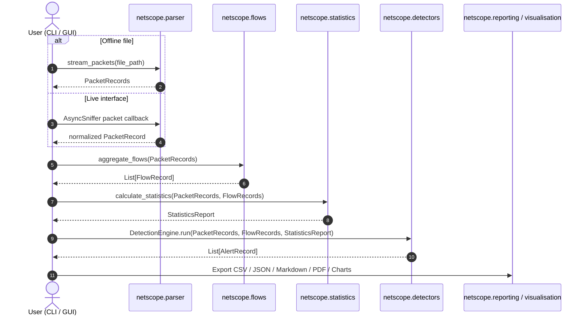

# NetScope Technical Architecture Specification

## 1. Architectural Principles

NetScope is engineered around five core software design principles:
1. **Decoupled Core Engine**: The parsing, flow aggregation, statistical analysis, and detection logic are entirely independent of GUI and CLI presentation layers.
2. **Defensive Analysis Sources**: Offline sources read saved PCAP/PCAPNG files; live capture opens only the interface explicitly selected by the user and never transmits packets.
3. **Bounded Memory Ingestion**: Offline parsing can stream files; live analysis retains a capped recent packet history and flow table, and recording is opt-in.
4. **Deterministic Canonical Keying**: Bidirectional network flows are identified through deterministic endpoint pair canonicalization, ensuring symmetric packet grouping regardless of capture initiation direction.
5. **Non-Blocking UI Concurrency**: Long-running packet analysis is delegated to background worker threads, communicating status and results to Tkinter through thread-safe message queues.

---

## 2. Component Structure and Responsibilities

```
netscope/
├── __init__.py         # Package exports and version metadata
├── cli.py              # Command-line interface with argparse and terminal formatting
├── config.py           # Configuration dataclasses, validation, and JSON serialization
├── detectors.py        # Rule-based explainable anomaly detection engine
├── exceptions.py       # Custom typed exception hierarchy
├── flows.py            # Bidirectional network flow aggregation engine
├── gui.py              # Tkinter/ttk desktop GUI with asynchronous worker threading
├── live.py             # Scapy interface discovery, capture lifecycle, bounded live analysis
├── models.py           # Dataclasses for PacketRecord, FlowKey, FlowRecord, AlertRecord, Summary
├── parser.py           # Scapy streaming reader, protocol extractors, wire-length logic
├── reporting.py        # CSV, JSON, Markdown, and PDF report export generators
└── visualisation.py    # Decoupled Matplotlib chart creation routines
```

### Module Breakdown

| Module | Primary Responsibility | Key Classes / Functions |
|---|---|---|
| `models` | Formal data schema definitions. | `PacketRecord`, `FlowKey`, `FlowRecord`, `AlertRecord`, `AnalysisSummary` |
| `exceptions` | Domain error hierarchy. | `InvalidCaptureError`, `UnsupportedCaptureFormatError`, `ConfigurationError` |
| `config` | Centralized detection and runtime parameters. | `DetectionConfig` |
| `parser` | Incremental PCAP dissection and validation. | `validate_capture_file`, `stream_packets`, `parse_capture` |
| `live` | Interface discovery, Scapy capture lifecycle, incremental processing and bounded history. | `discover_interfaces`, `LiveCaptureSession`, `LiveAnalyzer` |
| `flows` | Bidirectional flow keying and accounting. | `FlowAggregator`, `aggregate_flows` |
| `statistics` | Protocol distributions, rankings, percentiles. | `calculate_statistics`, `compute_packet_size_statistics` |
| `detectors` | Explainable anomaly evaluation. | `BaseDetector`, `DetectionEngine`, 6 Rule Implementations |
| `reporting` | Multi-format export routines. | `export_flows_csv`, `export_json`, `export_markdown_report` |
| `visualisation` | Standalone figure generation. | `plot_protocol_distribution`, `plot_traffic_over_time`, `save_all_charts` |
| `cli` | Terminal execution and stdout tables. | `run_analysis_pipeline`, `main` |
| `gui` | Interactive desktop application. | `NetScopeGUI`, `launch_gui` |

---

## 3. Data Processing Pipeline



---

## 4. Concurrency and Threading Model

Tkinter's main event loop (`mainloop()`) is single-threaded. Performing CPU-bound packet dissection or mathematical aggregation on the main thread would freeze window painting, dragging, and tab switching.

### Architecture:
1. **Worker Thread**: Analysis runs in a background daemon thread (`threading.Thread(target=self._worker_analysis, daemon=True)`).
2. **Message Queue**: Thread-safe communication occurs via `queue.Queue`.
3. **Event Polling**: The main GUI thread schedules periodic queue inspection using `self.after(100, self._poll_queue)`.
4. **State Isolation**: GUI components and Treeview tables are modified solely within the main thread upon dequeuing completion events.
5. **Live Capture Lifecycle**: Scapy capture and packet processing run outside Tk; a bounded event queue carries counters and alerts to the GUI polling loop. Capture shutdown closes any PCAPNG writer.

---

## 5. Computational Complexity

- **Packet Parsing**: $O(N)$ time, where $N$ is the number of packets in the capture. Space is bounded by $O(N)$ when fully buffered or $O(1)$ when streamed.
- **Flow Aggregation**: $O(N)$ amortized time. Hashing canonical `FlowKey` tuples yields $O(1)$ dictionary lookups. Offline space is $O(F)$; live flow and packet retention have configurable caps.
- **Statistical Percentiles**: $O(N \log N)$ time for array sorting via NumPy.
- **Sliding-Window Detectors**: $O(P \log P)$ time for sorting timestamps per endpoint, followed by a two-pointer scan with $O(P)$ time, where $P \le N$.
