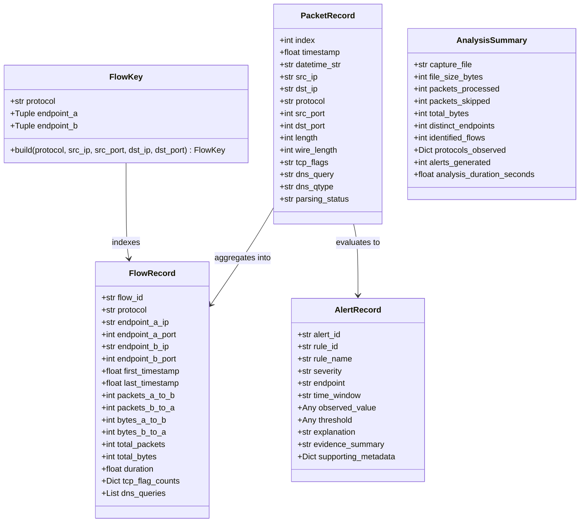

# NetScope Data Model & Canonical Flow Specification

## 1. Data Schema Hierarchy

NetScope defines lightweight, strongly typed `@dataclass` structures located in `netscope.models`:

---

## 2. Canonical Bidirectional Flow Keying

A fundamental challenge in network traffic analysis is grouping communication between two hosts into a single session, regardless of which host transmitted the first packet observed in the capture.

### The Algorithm:
1. Normalize Endpoint 1: $E_1 = (IP_{\text{src}}, Port_{\text{src}})$.
2. Normalize Endpoint 2: $E_2 = (IP_{\text{dst}}, Port_{\text{dst}})$.
3. If port is unavailable (e.g. ICMP, ARP), port defaults to `None`.
4. Perform deterministic tuple comparison using `(IP_str, port if port is not None else -1)`:
   - If $E_1 \le E_2$, then $\text{Endpoint}_A = E_1$ and $\text{Endpoint}_B = E_2$.
   - Else, $\text{Endpoint}_A = E_2$ and $\text{Endpoint}_B = E_1$.
5. The `FlowKey` is:
   $$\text{Key} = (\text{protocol.upper}(), \text{Endpoint}_A, \text{Endpoint}_B)$$

### Invariance Property:
For any packet $p_1$ from $(A, p_a) \to (B, p_b)$ and response packet $p_2$ from $(B, p_b) \to (A, p_a)$:
$$\text{FlowKey}(p_1) \equiv \text{FlowKey}(p_2)$$

### Directional Attribution:
When a packet is mapped to a flow:
- If packet source matches $\text{Endpoint}_A$, increment `packets_a_to_b` and add to `bytes_a_to_b`.
- Otherwise, increment `packets_b_to_a` and add to `bytes_b_to_a`.

---

## 3. Wire Length vs Captured Length Convention

Captures generated with snapshot limits (e.g. `tcpdump -s 96`) truncate packet payloads to save disk space.
- **Captured Length (`length`)**: The actual number of bytes written to the capture file.
- **Wire Length (`wire_length`)**: The original number of bytes the frame occupied on the physical network medium prior to truncation.

NetScope adheres to the following convention:
- Prefers `pkt.wirelen` if exposed by the capture format header.
- Falls back to `len(pkt)` if original wire length is absent.
- Documented in all summary cards and reports as *Observed Wire Bytes*.
