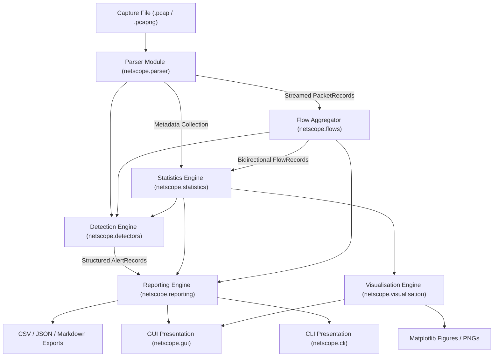

# NetScope Implementation Plan & Architecture Specification

## 1. Repository Audit
- **Project Location**: `C:\Users\jivan\.gemini\antigravity\scratch\netscope`
- **Environment**: Python 3.11.4 on Windows 11
- **Core Dependencies Verified**: Scapy 2.8.0, NumPy 2.1.3, Pandas 2.2.3, Matplotlib 3.10.7, Tkinter (built-in), Pytest 8.4.1, Git 2.52.0.
- **Initial Status**: New directory initialized with Git.

## 2. Proposed Project Structure
```
netscope/
    __init__.py
    cli.py              # CLI interface using argparse
    config.py           # Configuration dataclasses and JSON loading/validation
    models.py           # Dataclasses for PacketRecord, FlowRecord, AlertRecord, AnalysisSummary
    exceptions.py       # Custom typed exceptions
    parser.py           # PCAP/PCAPNG parsing via Scapy PcapReader with safe streaming
    flows.py            # Bidirectional flow aggregation engine
    statistics.py       # Traffic statistics, endpoint rankings, percentiles, time series
    detectors.py        # Rule-based explainable anomaly detection engine
    reporting.py        # CSV, JSON, and Markdown export generators
    visualisation.py    # Matplotlib plotting routines (decoupled from UI)
    gui.py              # Tkinter/ttk desktop GUI with background worker thread

tests/
    __init__.py
    conftest.py         # Pytest fixtures and synthetic packet generators
    test_parser.py      # Parser unit tests
    test_flows.py       # Flow aggregation unit tests
    test_statistics.py  # Statistical calculations unit tests
    test_detectors.py   # Detection rule unit and boundary tests
    test_reporting.py   # Export formatting and error handling tests
    test_cli.py         # CLI argument parsing and execution tests
    test_integration.py # End-to-end pipeline test

samples/
    generate_sample_pcap.py # Deterministic synthetic PCAP generator
    synthetic_demo.pcap     # Generated reproducible capture

docs/
    architecture.md
    detection_rules.md
    data_model.md
    testing.md
    interview_guide.md

reports/                # Destination for exported analysis runs
requirements.txt
pyproject.toml
.gitignore
README.md
```

## 3. Component Architecture & Data-Processing Pipeline


## 4. Flow-Aggregation Design
- **Endpoint Definition**: `(IP, Port)` for TCP/UDP; `(IP, None)` for ICMP/others; `(MAC, None)` for non-IP.
- **Canonical Bidirectional Key**: Ordered pair `(protocol, min(EP1, EP2), max(EP1, EP2))`.
- **Directional Tracking**: Packets from `min(EP1, EP2)` to `max(EP1, EP2)` are designated forward ($A \to B$), while reverse packets are designated reverse ($B \to A$).
- **Metrics Tracked**: Packets $A \to B$, Packets $B \to A$, Bytes $A \to B$, Bytes $B \to A$, First Timestamp, Last Timestamp, Duration, TCP flags, DNS queries.

## 5. Detection Rule Specifications
1. **High Packet Rate (`RULE_HIGH_PACKET_RATE`)**: Source IP packet count exceeds threshold within configured time window.
2. **Port Diversity (`RULE_PORT_DIVERSITY`)**: Source IP contacts > $N$ distinct destination ports within configured window (heuristic for port scans / discovery).
3. **Repeated TCP SYN without ACK (`RULE_SYN_WITHOUT_ACK`)**: Ratio of TCP SYN packets (without ACK) from a source exceeds ratio threshold over a minimum sample size (indicator of connection probes or incomplete handshakes).
4. **Traffic Volume Deviation (`RULE_VOLUME_DEVIATION`)**: Traffic volume in a time bucket deviates by > $Z$ standard deviations from the capture baseline.
5. **Endpoint Traffic Concentration (`RULE_TRAFFIC_CONCENTRATION`)**: A single endpoint accounts for > $P\%$ of total capture volume.
6. **Repeated Communication (`RULE_REPEATED_COMMUNICATION`)**: Unusually high burst of identical $(src, dst, dst\_port)$ transmissions in a short interval.

## 6. GUI Layout Plan
- Tkinter + ttk with modern styling and responsive grid layout.
- **Header**: File selection, Analysis execution button, Progress indicator, Real-time status.
- **Notebook Tabs**:
  - **Overview**: Executive metric cards (Packets, Bytes, Endpoints, Flows, Protocols, Alerts).
  - **Flows**: Treeview table of bidirectional flows with column-click sorting (numeric and text).
  - **Endpoints**: Top source/destination endpoints and port diversity tables.
  - **Alerts**: Severity-badged alerts table with master-detail pane showing explanation, evidence, and false positive notes.
  - **Charts**: Embedded Matplotlib canvas showing protocol pie, traffic time-series, endpoint bar chart, packet size histogram, and alert breakdown.
  - **Exports**: Controls to export CSVs, JSON, and Markdown reports.
- **Worker Threading**: Analysis runs on background thread (`threading.Thread`) using queue-based UI callbacks to ensure zero GUI freezing.

## 7. Testing Strategy
- **100% Offline Synthetic Fixtures**: Programmatically generate Scapy packets with exact timestamps, IPs, ports, and payload sizes.
- **Deterministic Assertions**: Unit tests for parser layers (IPv4, IPv6, TCP, UDP, ICMP, DNS), flow canonicalization, stats math (percentiles, zero-division, empty sets), detection threshold boundaries (below, at, above), and export formats.
- **Integration Test**: Complete end-to-end run verifying known packet counts, flow counts, alert triggers, and exports.
- **CLI & GUI Headless Tests**: CLI argument parsing, execution, and exit codes without opening windows.

## 8. Implementation Milestones
- **Milestone 1**: Foundation (Project structure, dependencies, models, config, exceptions).
- **Milestone 2**: Parser (Scapy streaming reader, protocol extractors, error handling).
- **Milestone 3**: Flow Engine (Bidirectional grouping, directional counters, timestamps).
- **Milestone 4**: Statistics Engine (Protocol distribution, endpoint rankings, packet size percentiles, time series).
- **Milestone 5**: Detection Engine (6 explainable rules, structured alert generation, evidence formatting).
- **Milestone 6**: Reporting & CLI (CSV, JSON, Markdown exports, argparse CLI).
- **Milestone 7**: Desktop GUI (Tkinter + ttk, tabs, table sorting, Matplotlib embedding, worker threads).
- **Milestone 8**: Synthetic Capture Generator & Comprehensive Automated Test Suite.
- **Milestone 9**: Complete Documentation & Technical Interview Preparation Guide.
